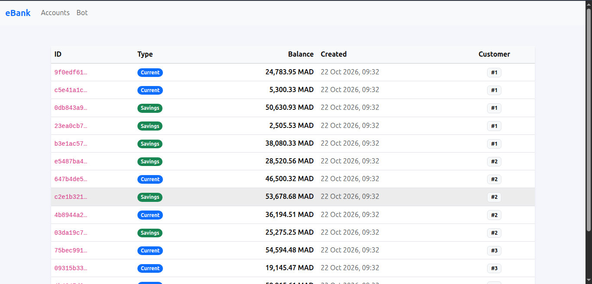
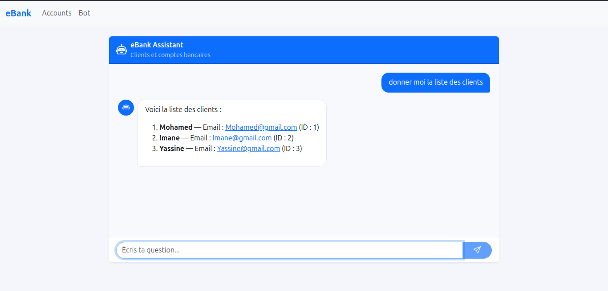
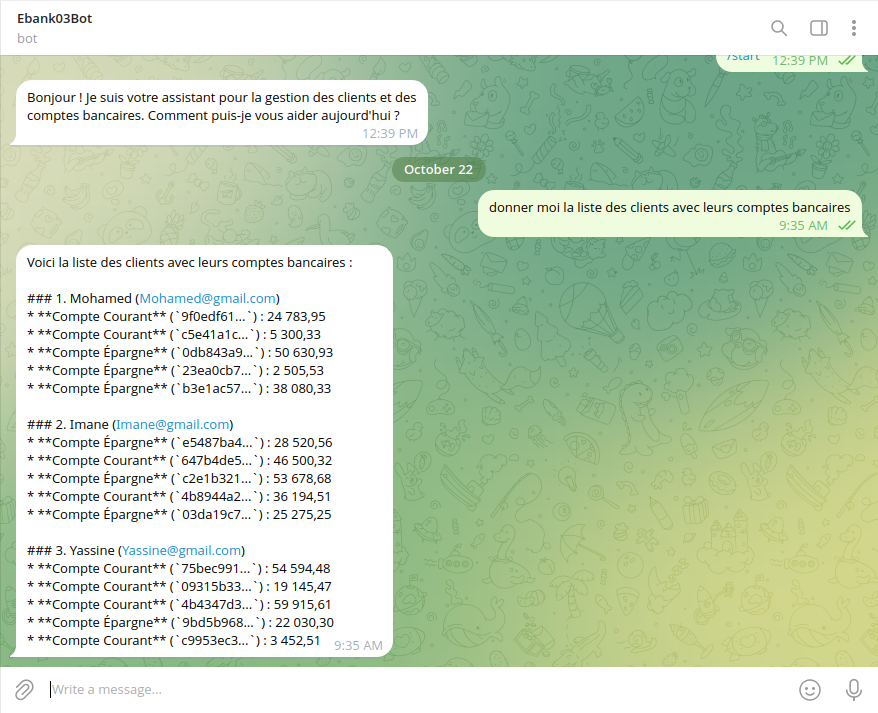
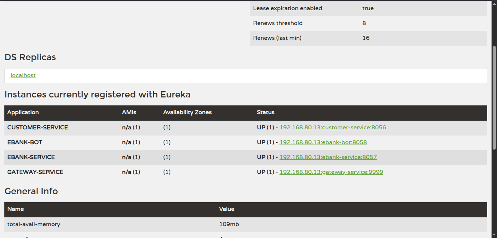

# eBank : Microservices & Agent IA


Gestion de clients et de comptes bancaires en **architecture microservices**, avec un **agent IA** qui interroge les services via le **Model Context Protocol (MCP)** et une interface **Angular** avec réponses en streaming.

## Aperçu

## Aperçu

<table>
  <tr>
    <td width="50%"><b>Comptes bancaires</b><br></td>
    <td width="50%"><b>Interface du bot (Angular)</b><br></td>
  </tr>
  <tr>
    <td width="50%"><b>Réponse en streaming</b><br></td>
    <td width="50%"><b>Registre Eureka</b><br></td>
  </tr>
</table>

<details>
<summary>Registre Eureka : tous les services enregistrés</summary>
<br>

</details>

## Architecture

```
Angular :4200 ──▶ gateway-service :9999 ──▶ customer-service :8056 ◀── OpenFeign ── ebank-service :8057
                          │                        (MCP server)                        (MCP server)
                          └──▶ ebank-bot :8058 ◀──────────── MCP client ────────────────────┘
                               (Spring AI + LLM, Telegram, Discord)

discovery-service (Eureka) :8761 : registre de tous les services
```

| Service | Rôle |
|---|---|
| `discovery-service` | Registre Eureka |
| `gateway-service` | Point d'entrée unique, routage dynamique, CORS |
| `customer-service` | Gestion des clients, serveur MCP |
| `ebank-service` | Gestion des comptes, serveur MCP, appelle `customer-service` via OpenFeign |
| `ebank-bot` | Agent IA (Spring AI), client MCP, connecteurs Telegram et Discord |
| `angular-front` | Interface web : comptes et chat avec l'agent |

## Points techniques

- **Résilience** : Circuit Breaker et fallback (Resilience4j). Si `customer-service` tombe, le compte est retourné avec un client par défaut.
- **Agent IA** : les services exposent leurs fonctionnalités comme *tools* MCP, découverts automatiquement par le bot au démarrage. Mémoire de conversation incluse.
- **Streaming** : réponses du LLM transmises en continu (`Flux` côté Spring, affichage progressif côté Angular).
- **Frontend** : Angular 21, Signals, intercepteur HTTP pour l'indicateur de chargement, rendu Markdown des réponses.
- **API** : documentation Swagger UI sur chaque service.

## Stack

- **Backend** : Java 21, Spring Boot, Spring Cloud (Eureka, Gateway, OpenFeign), Resilience4j
- **IA** : Spring AI, OpenAI, MCP
- **Frontend** : Angular 21, TypeScript, RxJS, Bootstrap 5

## Lancer le projet

Prérequis : Java 21, Maven 3.9+, Node.js, Angular CLI.

1. Démarrer dans l'ordre : `discovery-service`, `customer-service`, `ebank-service`, `gateway-service`, `ebank-bot`
2. Frontend :
```bash
   cd angular-front/angular-front
   npm install
   ng serve
```
3. Ouvrir http://localhost:4200 (Eureka : http://localhost:8761)

**Configuration** : aucun secret dans le code. Définir `OPENAI_API_KEY` (et les tokens Telegram et Discord pour les connecteurs) en variables d'environnement.

## Endpoints (via la gateway, port 9999)

| Méthode | Endpoint |
|---|---|
| GET, POST | `/CUSTOMER-SERVICE/customers` |
| GET, POST | `/EBANK-SERVICE/account` |
| GET | `/EBANK-BOT/chat?query=...` |
| GET | `/EBANK-BOT/chatStream?query=...` (streaming) |

## Auteur

**Hajar Boulmane** : Génie Logiciel et Systèmes Distribués, ENSET Mohammedia
[GitHub](https://github.com/HajarBoulmane)